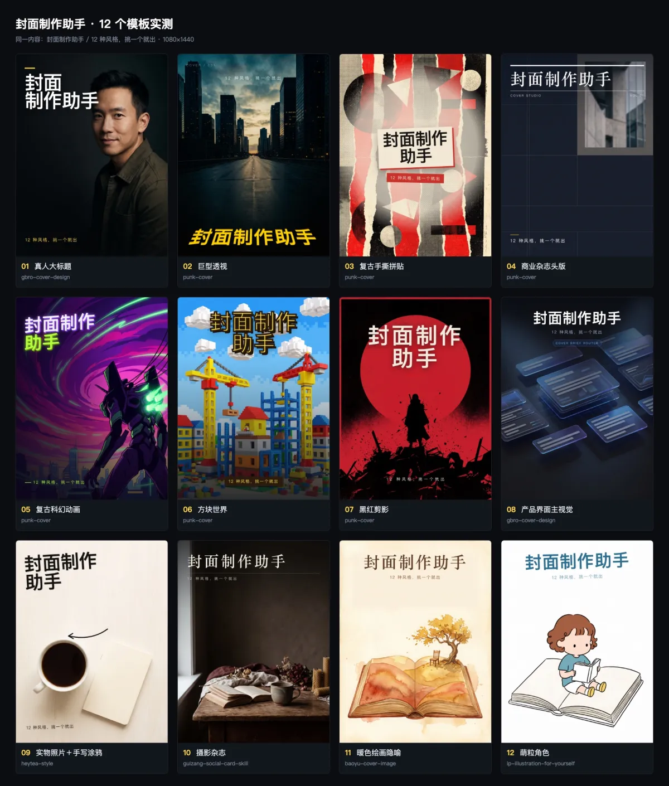

# 小红书、视频号、公众号封面助手

先看样图选风格，再定文案与平台；确认后制作封面。十个出图技能随包附带，首次制作前离线装好，不用联网下载，也不用自己满脑子想提示词。

## 包含什么

- 完整交互流程：看例图选风格 → 定文字素材 → 确认平台尺寸 → 复述方案等确认 → 制作检查 → 按反馈修改。
- 12张可见风格案例及来源记录：真人大标题、巨型透视、复古拼贴、商业杂志、复古科幻、方块世界、黑红剪影、产品主视觉、实物涂鸦、摄影杂志、暖色绘画、萌粒角色。
- 随包的十个出图技能（七个技能家族）＋离线装配器：首次制作前把包内副本解包到技能目录，正常路径不联网、`network_downloads` 为 0。已有技能不更新不覆盖，明确关闭的技能不重新启用。
- 已确认需求交接模板、不同出图技能的执行适配说明和验收规则。

## 你怎么用

安装本技能后说：

> 我想给这个视频做封面，先给我看看风格。

或者：

> 这篇文章要发小红书，帮我做个封面。

封面助手会先给你6–8个代表性例图，并推荐1–2种。选好风格再建议标题、确认素材，问清发布平台与尺寸，最后复述方案。你同意后才制作。

例图只用于参考外观，原图的文字、人物和品牌不会照搬。选风格时不会提前生成你的成品。

## 安装

把本技能目录放到支持SKILL.md的环境中。压缩包根目录只有一个SKILL.md，适合单技能安装；十个第三方技能已随包附带，发布包里是 `vendor/cola-skills-bundle.zip`（仓库里是可读的 `vendor/<技能目录>/`），首次制作前离线解包，不再运行时下载。

- Cola：本技能目录放到 `~/.cola/skills/cover-brief-router/`。
- 其他本地环境：放到对应的skills目录；运行时按自己的实际目录执行检测安装。

首次制作前离线装配（推荐；只解包包内副本，不联网）：

```bash
python3 scripts/ensure_dependencies.py --json
```

只读复核，不落盘不联网：

```bash
python3 scripts/ensure_dependencies.py --check --json
```

自定义目标目录：

```bash
python3 scripts/ensure_dependencies.py --skills-dir /你的技能目录 --json
```

## 运行条件与边界

离线装配需要Python3与文件权限；正常路径不需要联网，只有随包 `vendor/` 被裁掉时脚本才按清单固定 commit 联网兜底。图像型风格需要当前环境有可用图像生成/编辑能力；精确排版路线需要浏览器渲染能力。安装技能不会自动附送图像服务、API额度、账号、照片或其他人的默认配置。

装配器只解压包内随附文件，不自动执行第三方代码、安装系统软件或支付。包内副本缺失、明确禁用、已有目录不完整时会报告具体项目，保留其他可用项。

随包12张案例中01–09为作者现成例图、10–12为新制视觉样张；案例代表外观参考，不证明每条原生流程都已跑通。归藏第10张为视觉规范生成样张，不是HTML渲染实测。一稿多发收录在依赖清单，但暂未提供合格独立封面案例，不列入默认风格选择。

## 来源

本包提供流程、装配器、案例库，并随包附带十个第三方技能的固定 commit 快照；版权与许可仍归原作者。技能来源与案例出处见 `references/dependencies.json`、`references/style-samples.md` 和 `NOTICE.md`。这不是喜茶或其他品牌的官方产品。

## 12 个模板实拍

同一内容、12 种方向各出一张 1080×1440 成品，用于直观比较可选风格：



单张、对应来源与制作说明见 `assets/templates/README.md`。
